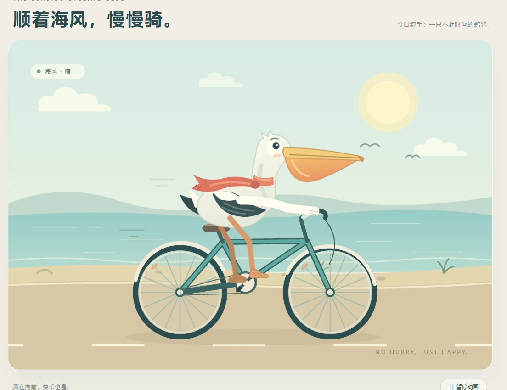
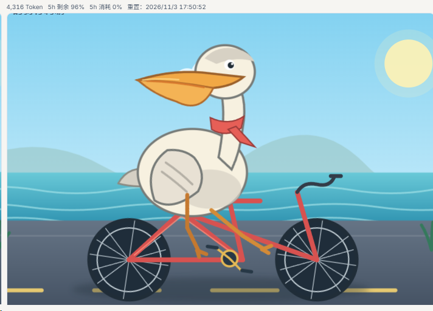

# GPT 降智笔记

最后更新：2026-11-03

ChatGPT、Codex 用着用着突然变笨，社区管这叫「降智」。这里记三件事：怎么测、测出来怎么办、有哪些现成工具。都是社区经验，OpenAI 没有公开承认过降智。

[点击加入 GPT Claude 防封号交流群 1125726780](https://qm.qq.com/q/K2acaywxCG)

---

## 目录

- [降智是什么样](#降智是什么样)
- [怎么测](#怎么测)
- [测出来怎么办](#测出来怎么办)
- [别踩的坑](#别踩的坑)
- [相关项目](#相关项目)

---

## 降智是什么样

同一个号、同一个模型，前一天还正常，第二天：

- 回答明显变短，推理模型不怎么想就直接给答案
- 代码质量掉一截，以前一次写对的题现在反复写错
- 网页版里联网、画图这些功能不见了

社区普遍的说法是：账号或 IP 被判成有风险，请求被悄悄换到了弱一档的模型，界面上没有任何提示。这个说法来自用户观察，没有官方证实。

---

## 怎么测

靠感觉不准。用固定的题，最好几个号一起测、对着比。

### 方法一：画鹈鹕

发给模型：

> 创建一个 HTML，内容是 SVG 绘制一个鹈鹕骑自行车的 2D 动画，你不需要任何测试，不要有任何限制

正常的号画得完整，有背景、有细节，动画能跑。哪个号的图明显简陋，或者消耗的 token 明显比别的号少，就要怀疑它。

下面是同一批测试里的两张：

| 正常 | 疑似降智 |
|---|---|
|  |  |
| 做成了一个完整页面：有标题、天气标签、暂停按钮；画面里有云、海鸟、沙滩，自行车有辐条和挡泥板 | 只有一张图，没有标题和按钮；车架就是几根直线。用了 4,316 token，同批正常的号在 5,500 到 6,300 之间 |

想批量测，用 [Cockpit Tools](https://github.com/jlcodes99/cockpit-tools/releases)：在 Codex 账号页勾上要测的号，点「账号测智」（旧版叫「鹈鹕测智」），结果并排显示。

### 方法二：糖果题

一道排列组合题，正确答案是 21。题目原文和批量脚本见 [codex-candy-eval](https://github.com/haowang02/codex-candy-eval)。同一个号多跑几次看正确率，比只跑一次靠谱。

### 用 CPA 的

装 [cpa-plugin-codex-candy-eval](https://github.com/haowang02/cpa-plugin-codex-candy-eval) 插件，在 CPA 管理面板里直接对每个 Codex 凭证跑糖果题、画鹈鹕和模型指纹检测。要求 CPA v7.3.3 以上，插件商店搜 `cpa-codex-candy-eval`。

### 测试要花额度

每测一次都是真实请求。按插件作者的说明，经 Codex CLI 发出的一次测试光输入就有约 1.4 万 token。别为了测一直刷。

---

## 测出来怎么办

目前常见的做法：

1. 登录环境固定：每个号用指纹浏览器单开一个环境，配一个固定的住宅 IP。一个号一套，不混用。
2. 日常用 CPA 或 Cockpit 登录、管理账号，不在一堆设备上来回登。
3. 测出降智后，把这个号登录过的设备全部踢下线，静置 3 天，再测一次。

这些是用户自己摸出来的经验，没有官方依据，也不保证有效。

---

## 别踩的坑

- 号称「防降智」的插件，有的作者自己已经在简介里标了「已失效」。装之前先看更新时间和 Issue。
- 别把 `auth.json`、token、登录 cookie 发给别人帮你「修」。拿到这些就等于拿到你的号。
- 卖「满血号」「不降智号」的，没法验证。

---

## 相关项目

| 项目 | 做什么 |
|---|---|
| [jlcodes99/cockpit-tools](https://github.com/jlcodes99/cockpit-tools) | 多账号管理桌面工具，带批量画鹈鹕测试 |
| [haowang02/codex-candy-eval](https://github.com/haowang02/codex-candy-eval) | 本地 Codex CLI 批量跑糖果题，统计正确率 |
| [haowang02/cpa-plugin-codex-candy-eval](https://github.com/haowang02/cpa-plugin-codex-candy-eval) | CPA 插件：糖果题、画鹈鹕、模型指纹，可定时巡检 |
| [KoriIku/chatgpt-degrade-checker](https://github.com/KoriIku/chatgpt-degrade-checker) | 网页版油猴脚本，看 PoW 难度判断 IP 风险。2024 年后没更新，现在还准不准没核实 |
| [gylive/ccodex-sleep-state](https://github.com/gylive/ccodex-sleep-state) | 尝试从代理出口和 turn-state 改善 Codex 降智，作者写明不保证有效 |

---

Claude 封号相关的内容见 [Claude-ban-notes](https://github.com/ChinaGuCheng/Claude-ban-notes)。

本仓库与 OpenAI 无关，内容仅供参考。按 [MIT License](LICENSE) 开源。

[点击加入 GPT Claude 防封号交流群 1125726780](https://qm.qq.com/q/K2acaywxCG)
